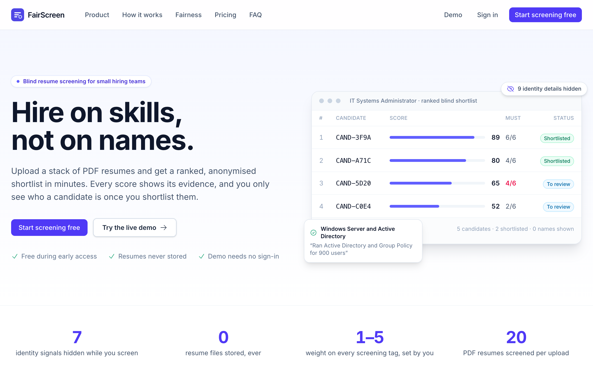
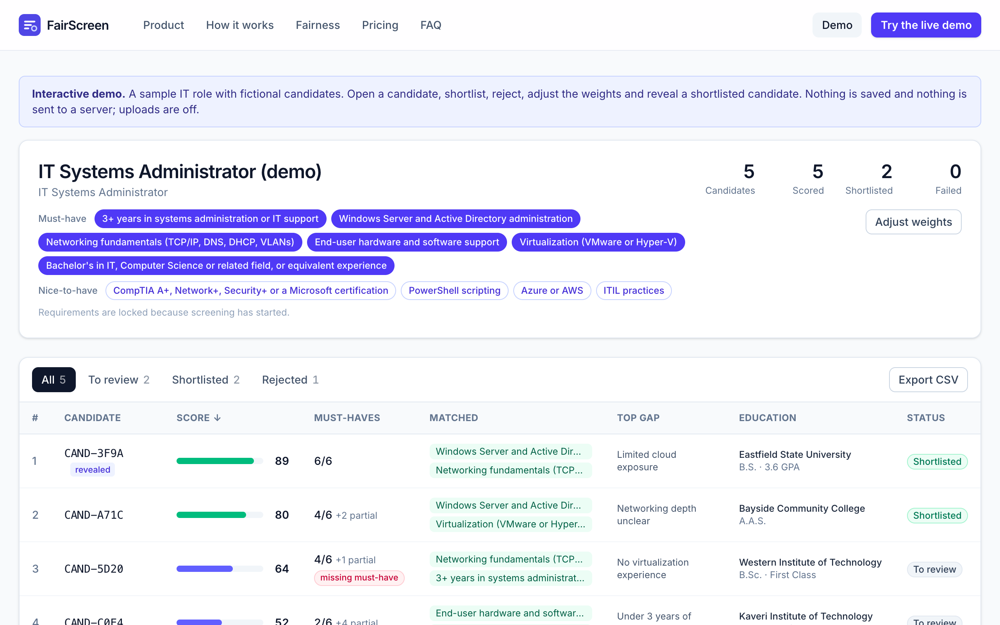
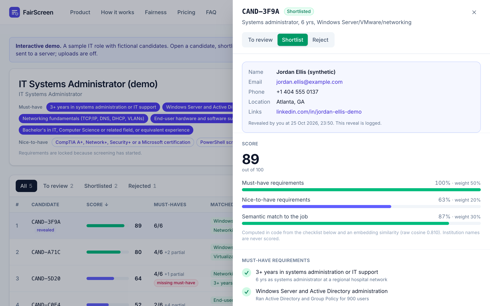
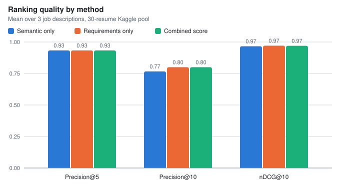

# FairScreen: blind resume screening

A recruiter pastes a job description and uploads a batch of PDF resumes. FairScreen returns a ranked **blind** shortlist: each candidate gets a score, a requirement-by-requirement checklist with evidence and a two-sentence explanation, without the recruiter seeing names or other identity details until they shortlist someone.

Built entirely on pretrained models through APIs (Gemini), with **no model training**.

- **Live site:** <https://askretik.github.io/fairscreen/>
- **Interactive demo (no sign-in, no server):** <https://askretik.github.io/fairscreen/demo>

The site deploys to GitHub Pages on every push to `main`. Until the backend is connected (see [Deploying](#deploying)) it runs **demo-only**: the landing page and the demo work, and sign-in is hidden.



| Ranked blind table | Candidate drawer |
|---|---|
|  |  |

*(The demo uses placeholder data with fictional candidates until `build_demo.py` has run on real model output.)*

## The problem

Small companies screen 10–50 applicants per role by hand. That is slow, inconsistent, and exposed to bias from names, gender, age and location. Keyword-matching ATS tools miss candidates who describe the same skill in different words.

## How it works

1. **Paste the job description.** Gemini extracts 3–8 must-have and 0–8 nice-to-have requirements; the recruiter edits them before screening starts.
2. **Upload up to 20 PDF resumes.** Each one is parsed, anonymised, checked against every requirement and scored in the background, with live progress.
3. **Review the ranked blind shortlist.** Every score comes with evidence. Shortlist a candidate to reveal who they are; each reveal is logged with time and user.

A failed resume can be retried from the browser tab that uploaded it (the tab still holds the file; the server never stores PDFs). Recruiters can also re-weight the score with sliders and delete a job.

## Architecture

```
Browser (React, Firebase Hosting)
  │  Firebase Auth (Google) → ID token
  │  Firestore onSnapshot (read-only: jobs, candidates)  ◄── live progress
  │
  └─ HTTPS + Bearer ID token ──► FastAPI (Render)
                                   ├─ verifies token (firebase-admin)
                                   ├─ Gemini: parse JD, parse resume PDF, evaluate, embed
                                   ├─ blind.py: redaction safety net
                                   ├─ scoring.py: deterministic score
                                   └─ writes Firestore (admin SDK)
```

- All writes go through the backend; Firestore security rules make the client read-only, and identity lives in a backend-only document.
- Resume PDFs are processed **in memory** and discarded; they are never stored or logged.
- Per resume: one parse call (Flash-Lite, PDF sent inline, structured output), the redaction safety net, one evaluation call (Flash) that sees **only the blind profile**, one embedding, then a score computed in Python.

## Blind-screening policy

| Field | While screening | After reveal (shortlisted only) | Stored? |
|---|---|---|---|
| Name | Hidden; shown as an anon ID like `CAND-7F3A` | Shown | Yes, in the private identity doc |
| Email, phone | Hidden | Shown | Yes, in the private identity doc |
| Profile links | Hidden | Shown | Yes, in the private identity doc |
| Photo | Hidden (a "photo present" flag only) | Not shown | No |
| Location / address | Hidden | Shown | Yes, in the private identity doc |
| Age / date of birth | Hidden | **Never shown** | **No** |
| Gender indicators (pronouns, titles) | Hidden; pronouns neutralised | **Never shown** | **No** |
| College, degree, field, grade, graduation year | Visible | Visible | Yes |
| Employers, titles, dates | Visible | Visible | Yes |
| Skills, projects, certifications | Visible | Visible | Yes |

**College is visible but never scored.** Education counts only when the job states an education requirement, and then by degree and field, not institution. The embedding text leaves out institution and employer names too.

**Redaction has two layers.** (1) The parse prompt puts identity only in an `identity` block and writes every summary in neutral third person. (2) `backend/app/blind.py` is a deterministic, unit-tested safety net over every string in the blind profile: it removes emails, phone numbers, URLs, the candidate's name (full and parts), and their location, and neutralises gendered pronouns and titles. Every replacement is counted and shown in the UI ("9 identity details redacted"). On top of that, `run_local.py` and `build_demo.py` run a leak check that searches the final blind data for the identity's name, email, phone and links.

## Scoring

```
must     = (met + 0.5 × partial) / n_must            (1.0 if there are no must-haves)
nice     = (met + 0.5 × partial) / n_nice            (1.0 if there are no nice-to-haves)
semantic = clip((cosine − LO) / (HI − LO), 0, 1)     LO, HI calibrated on the eval pool
total    = 100 × (0.5 × must + 0.2 × nice + 0.3 × semantic)
```

The LLM judges each requirement; the number is computed in code, so it is reproducible, explainable, and re-weightable without new API calls (the weight sliders re-rank live). A missing must-have shows a badge but never auto-rejects.

## Evaluation

Offline, on the Kaggle [Resume Dataset](https://www.kaggle.com/datasets/snehaanbhawal/resume-dataset) (Snehaan Bhawal): a fixed pool of 30 resumes (8 from each of IT, Finance and HR, plus 6 from other categories, seed 42, IDs in `backend/eval/pool.json`), scored against one realistic JD per category (`backend/eval/jds/`). A resume counts as relevant when its category matches the JD's.

*(Fill in after running `python eval/run_eval.py`; the full tables are in [`backend/eval/results/ablation.md`](backend/eval/results/ablation.md).)*

| Method | Precision@5 | Precision@10 | nDCG@10 |
|---|---:|---:|---:|
| Semantic only | – | – | – |
| Requirements only | – | – | – |
| Combined score | – | – | – |



With 8 relevant resumes per JD, the best possible precision@10 is 0.8. Cosine calibration: `LO`/`HI` in `backend/app/scoring.py` are set to the 10th/90th percentiles of the raw cosine over all (JD, resume) pairs; the values used are recorded in `metrics.json`.

## Limitations and trade-offs

- **Category labels are only a proxy for relevance.** An "IT" resume is not necessarily a fit for a specific IT job, and a resume from another category can still meet the requirements.
- **Graduation year is visible** as part of academics, by design. It is a known age proxy.
- **Free-tier data use.** On the Gemini free tier, Google may use prompts and responses to improve its products. The demo and the evaluation use only public (Kaggle) or **synthetic** resumes. A production deployment would use the paid tier, which excludes this.
- **Synthetic resumes.** The Kaggle resumes carry no names or contact details, so the demo adds four fictional people (`backend/eval/synthetic/`, generated by `backend/scripts/make_synthetic_resumes.py`) to show blind mode and reveal. They are labelled synthetic in the PDF and in the UI.
- **Scale.** Free-tier rate limits, in-process background tasks and Render's free instance (which sleeps and restarts) suit tens of resumes per job, not thousands; 1,000 resumes per job would need the batch API or paid tier and a real job queue.
- **Render cold start.** The first request after the backend sleeps can take up to a minute; the app shows a banner, and `/demo` doesn't need the backend at all.

## Privacy and security

- Raw PDFs are never stored or logged; uploads are kept in memory (Starlette's spool-to-disk threshold is raised above the 5 MB limit).
- Logs contain IDs only, never identity fields.
- Identity sits in a backend-only Firestore document (`jobs/{id}/candidates/{id}/private/identity`); reveal is gated on shortlisting and records `revealedAt` and `revealedBy`.
- Age, date of birth and gender are never stored.

## Running it locally

**Backend** (Python 3.11+):

```bash
cd backend
python3 -m venv .venv && .venv/bin/pip install -r requirements.txt
cp .env.example .env            # fill in GEMINI_* and FIREBASE_SERVICE_ACCOUNT_B64
.venv/bin/python -m pytest      # tests; no network needed
.venv/bin/uvicorn app.main:app --reload --port 8000   # API at http://localhost:8000/docs
```

Pipeline without Firestore (Phase 1 checkpoint):

```bash
.venv/bin/python scripts/run_local.py --jd eval/jds/information-technology.txt --resumes <folder of PDFs>
```

**Frontend** (Node 20+):

```bash
cd frontend
npm install
cp .env.example .env            # VITE_API_URL and the Firebase web-app config
npm run dev                     # http://localhost:5173
npm test                        # unit and blind-rendering tests
```

**Demo data and evaluation:**

```bash
cd backend
.venv/bin/python scripts/make_synthetic_resumes.py
.venv/bin/python scripts/build_demo.py --jd eval/jds/information-technology.txt --resumes eval/synthetic <folder of ~6 Kaggle IT PDFs>
.venv/bin/python eval/run_eval.py --dry-run   # shows the pool and the API-call plan
.venv/bin/python eval/run_eval.py             # resumable; throttled by GEMINI_*_RPM in .env
```

## Deploying

**Frontend → GitHub Pages (automatic).** `.github/workflows/ci-deploy.yml` runs the backend and frontend tests on every push and pull request, and on `main` builds the frontend with the base path `/<repo>/` and deploys it to Pages (Settings ▸ Pages ▸ Source: GitHub Actions). `404.html` (and `demo/index.html`, since `/demo` is also the folder holding the demo data) is a copy of `index.html`, so deep links work.

**Backend → Render.** [](https://render.com/deploy?repo=https://github.com/ASKretik/fairscreen), or New ▸ Blueprint ▸ this repo (`render.yaml`). Render asks for `GEMINI_API_KEY`, `GEMINI_PARSE_MODEL`, `GEMINI_EVAL_MODEL` and `FIREBASE_SERVICE_ACCOUNT_B64`; `ALLOWED_ORIGINS` already includes `https://askretik.github.io`. Check `https://<service>.onrender.com/health`.

**Turning on sign-in on the live site:**

1. Firebase console: enable **Google** sign-in, create **Firestore** (production mode), register a **web app**, and add `askretik.github.io` under Authentication ▸ Settings ▸ Authorised domains.
2. Deploy the security rules: `npx firebase-tools deploy --only firestore:rules` (after putting the project ID in `.firebaserc`).
3. Give the build the web-app config and the API URL as repository **variables** (they are public identifiers, not secrets), then re-run the workflow:

   ```bash
   gh variable set VITE_API_URL --body "https://<service>.onrender.com"
   gh variable set VITE_FIREBASE_API_KEY --body "<apiKey>"
   gh variable set VITE_FIREBASE_AUTH_DOMAIN --body "<project>.firebaseapp.com"
   gh variable set VITE_FIREBASE_PROJECT_ID --body "<project>"
   gh variable set VITE_FIREBASE_APP_ID --body "<appId>"
   gh workflow run ci-deploy.yml
   ```

**Alternative: Firebase Hosting** (SPEC §3). `cd frontend && npm run build`, then `firebase deploy --only hosting` from the repo root, and add the hosting URL to `ALLOWED_ORIGINS` on Render and to Firebase Auth's authorised domains.

## Repository layout

```
SPEC.md  PLAN.md  README.md  CLAUDE.md  decisionsp4.md
firebase.json  firestore.rules  .firebaserc  render.yaml
.github/workflows/ci-deploy.yml   tests + GitHub Pages deploy
backend/
  app/        main.py config.py auth.py deps.py models.py blind.py scoring.py cache.py leaks.py
              routers/{jobs,candidates}.py  services/{gemini,pipeline,firestore}.py
  scripts/    run_local.py  build_demo.py  make_synthetic_resumes.py
  eval/       run_eval.py  metrics.py  chart.py  jds/  synthetic/  results/  data/ (gitignored)
  tests/
frontend/
  src/        pages/  components/  lib/  auth/  types.ts
  public/demo/demo_job.json
```

Design decisions and assumptions made during implementation are logged in [`decisionsp4.md`](decisionsp4.md).
